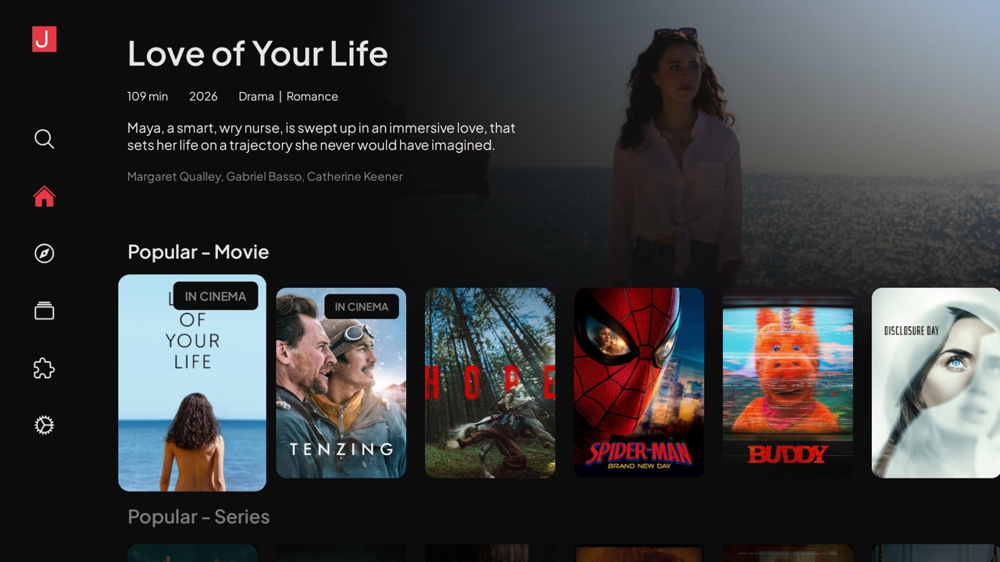
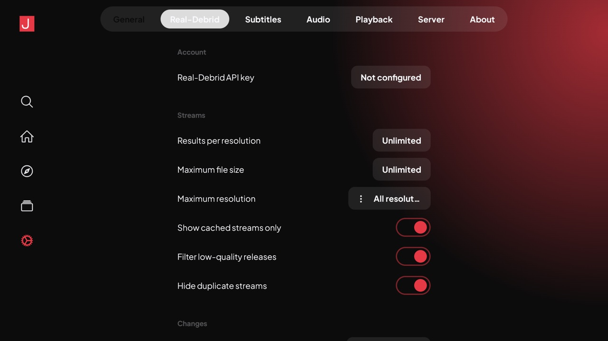
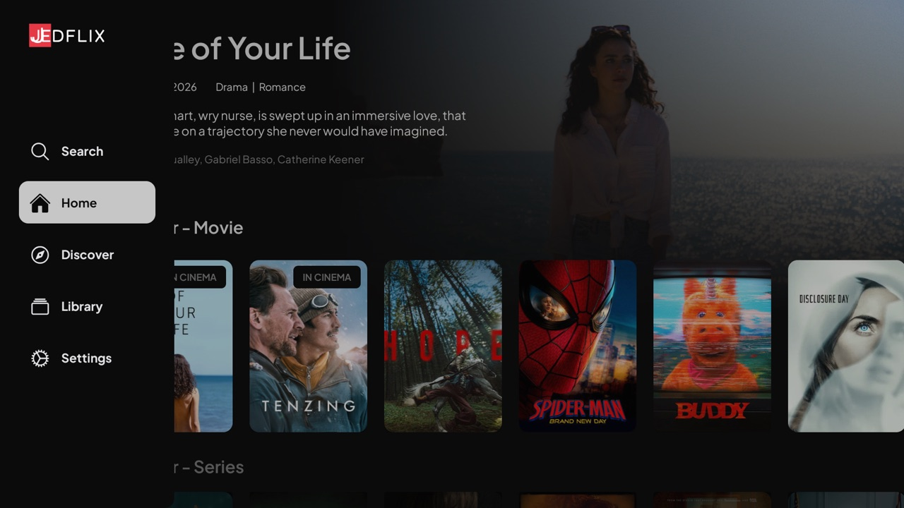

# Jedflix for Android TV

Jedflix is a personal fork of the official **Stremio Android TV 1.10.4** app.
It is built by patching Stremio's released APK for ARM64 TVs and x86_64 emulators,
so playback, addons, and library sync stay on Stremio's engine while Jedflix adds
a black-and-red theme, a fixed Real-Debrid setup, and its own update channel.

This repository contains the repeatable APK patch tooling, not Stremio's source.
Jedflix is not affiliated with Stremio.

## Features

- **Stremio under the hood.** Rebranded launcher, splash, wordmark, and a black/red
  theme. Stremio account, service URLs, addon compatibility, decoders, and video
  acceleration remain upstream.
- **Real-Debrid built in.** A dedicated Settings → Real-Debrid screen drives the
  managed Comet source. Pair from your phone by QR code or paste a key; keys are
  validated with Real-Debrid and stored encrypted on the device. Set resolution,
  size and result limits, cached-only, and stream filters.
- **Skip Intro.** Stremio's player already surfaces Skip Intro / Skip Outro
  prompts; the fork keeps it and the rest of the player intact.
- **Self updater.** Settings → About shows the Jedflix version and checks this
  repository's latest stable GitHub release. Updates are matched to the CPU
  architecture and verified against the installed signature, package, version
  code, exact size, and SHA-256 before Android installs them.
- **Curated sources.** Cinemeta + Comet only. Addon install/remove controls and
  upstream addon promotions are disabled.
- **Two architectures.** ARM64 for physical TVs, x86_64 for the development
  emulator.

### Audio normalization and dialogue boost

The player Audio menu includes **Night mode**, an optional FFmpeg compressor and
peak limiter that raises quiet passages and reduces loud scenes. It defaults to
Off, remembers your choice, and switches playback to the existing mpv engine
when enabled. It uses decoded PCM, temporarily disabling compressed passthrough.
This is dynamic range compression; it does not isolate speech from a mixed
soundtrack or pre-scan movies for loudness matching.

The build replaces only `libavfilter.so` with a compatible FFmpeg 8.1 build.
The first build downloads the pinned Android NDK r28c (about 1 GB); later builds
reuse checked outputs. See [Night mode](docs/audio-night-mode.md) for controls
and verification, and [native build details](docs/audio-native-build.md) for the
source, toolchain, and ABI checks.

## Screenshots

| Home | Real-Debrid |
| --- | --- |
|  |  |



## Build

Requires Java, Python 3.12+, make, curl, and Android SDK Build Tools 36.0.0. The default SDK
location is `~/Library/Android/sdk`; override `ANDROID_HOME` or `BUILD_TOOLS` if
needed.

```bash
./scripts/build.sh x86_64   # -> dist/jedflix-android-tv-1.10.4-x86_64.apk
./scripts/build.sh arm64    # -> dist/jedflix-android-tv-1.10.4-arm64.apk
```

The build downloads pinned upstream APKs and apktool, verifies their SHA-256
hashes, patches resources and smali, rebuilds, aligns native libraries to 16 KB,
and signs with a locally generated development key. Signature and alignment
checks run at the end.

Downloads, decoded resources, and the signing key live in `.local/` and are
excluded from Git. Keep `.local/jedflix-local.jks` to install future builds over
this one.

## Development emulator

Dev builds run on a shared Windows emulator over SSH. Use the wrapper so the
remote adb server behaves like a local device:

```bash
./scripts/dev.sh            # build x86_64, install, cold start
./scripts/dev.sh --no-build # reinstall the existing APK
./scripts/adb.sh devices
```

The AVD is x86_64, so the ARM64 artifact cannot be installed there. See
[AGENTS.md](AGENTS.md) for host details and device controls.

## Updates and releases

The updater reads the latest stable release of
[`JedBorseth/jedflix-tv-stremio`](https://github.com/JedBorseth/jedflix-tv-stremio).
A release must include `jedflix-update.json` plus the versioned ARM64 and x86_64
APKs. See [docs/updates.md](docs/updates.md) for the manifest contract and
`scripts/prepare-update.py` for generating release files.

Pushing source alone does not publish an update. Always keep the same signing
keystore: changing it breaks updates for installed builds.

## More documentation

- [feasibility.md](docs/feasibility.md) — what was tested on device
- [managed-addons.md](docs/managed-addons.md) — addon lock and Real-Debrid details
- [audio-processing.md](docs/audio-processing.md) — audio work research
- [updates.md](docs/updates.md) — update manifest and release steps
